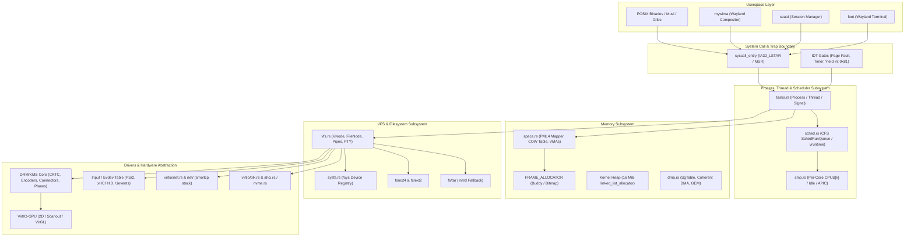
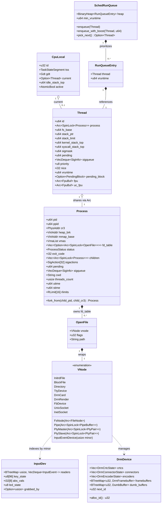
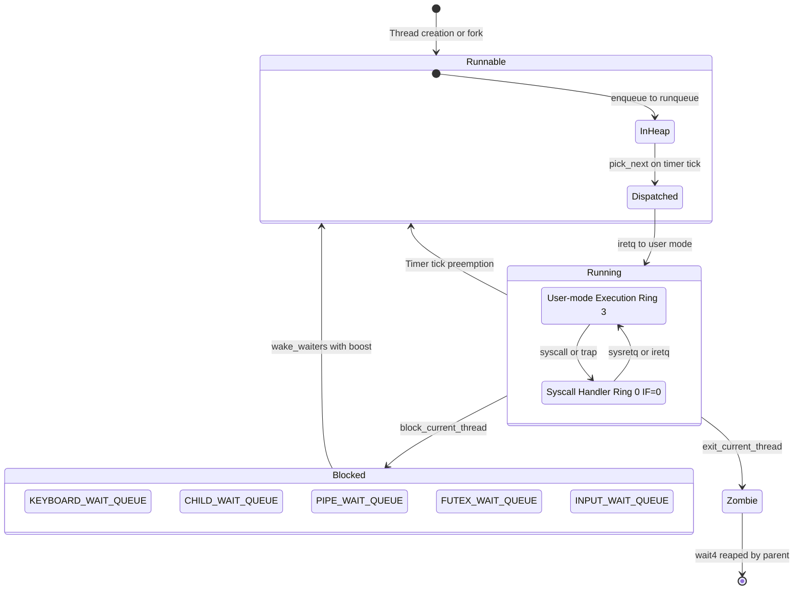
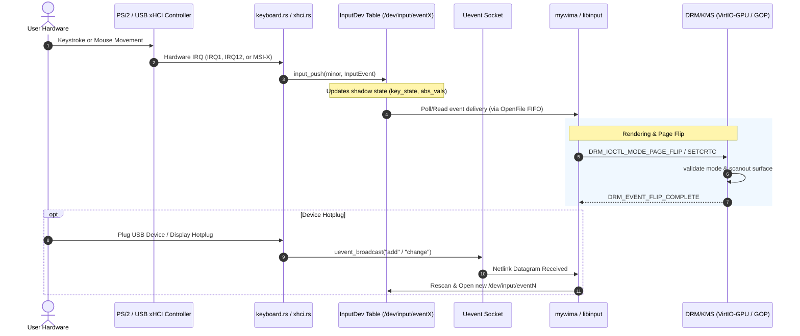

# DragOS Kernel Architecture & UML Diagrams

This document outlines the core architecture and object relationships of the **DragOS** microkernel/hybrid kernel codebase. DragOS is a 64-bit multi-core (`x86_64`) operating system written in Rust (`no_std`), targeting modern hardware (APIC, SMP, ACPI, VirtIO, PCI, DRM/KMS, USB xHCI) with a POSIX/Linux-compatible system call interface.

---

## 1. High-Level Subsystem Architecture

The kernel is structured into modular layers spanning architecture support, memory management, multiprocessing/scheduling, virtual filesystem, driver frameworks, and POSIX syscall emulation:

---

## 2. Core Kernel Class / Struct UML Diagram

Below is the UML class diagram representing the primary data structures, their internal fields, and ownership/referential relationships (`Arc`, `SpinLock`, compositions):

---

## 3. Thread State & Scheduling Lifecycle

State transitions of a `Thread` managed by the Completely Fair Scheduler (CFS) and per-core APIC timer interruptions:

---

## 4. Input & KMS Graphics Event Flow

Flow of hardware interrupts from input devices and GPU frame completion into userspace compositors and terminals:

---

## 5. Summary of Key Invariants

1. **Lock Hierarchy**: `SCHEDULER` $\to$ `CPUS[k]` $\to$ wait queues $\to$ `process.lock()`.
2. **Interrupt Model**: Spinlocks preserve and restore `RFLAGS.IF`. Non-preemptible syscall Rust dispatcher runs with `IF=0`.
3. **Execution Trail**: Clean, deterministic transition from `kernel_main` to the first user-mode `iretq`.
